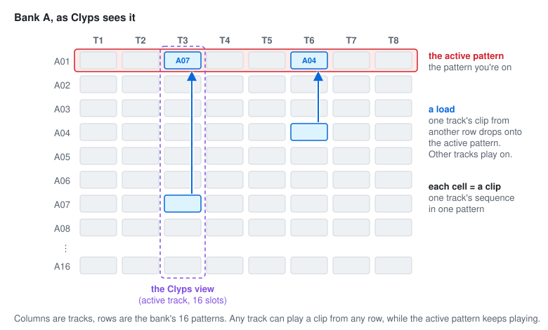
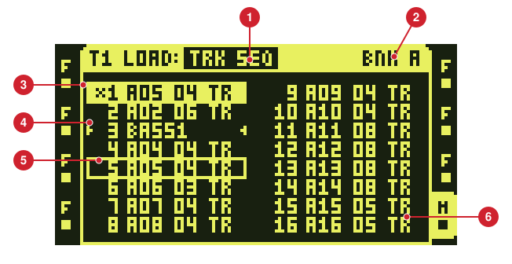
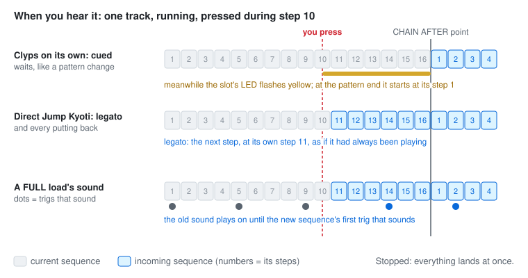

# Clyps — user manual

*Draft for review. Outline and voice approved by the author, 2026-11-15. This is a living document: it changes
whenever Clyps does. It covers both firmware images that carry Clyps, KYOTI with Clyps and the standalone Clyps image (§11); both
include Direct Jump Kyoti.*

1. [What Clyps is](#1-what-clyps-is)
2. [The big ideas](#2-the-big-ideas)
3. [The controls' grammar](#3-the-controls-grammar)
4. [Opening Clyps and reading the view](#4-opening-clyps-and-reading-the-view)
5. [Load types](#5-load-types)
6. [Aiming: the arrows and the box](#6-aiming-the-arrows-and-the-box)
7. [Multi: several tracks at once](#7-multi-several-tracks-at-once)
8. [Banks, patterns and Direct Jump Kyoti](#8-banks-patterns-and-direct-jump-kyoti)
9. [Peeking at a parameter page](#9-peeking-at-a-parameter-page)
10. [Naming sequences](#10-naming-sequences)
11. [Saving, memory and the two builds](#11-saving-memory-and-the-two-builds)
12. [Best practices](#12-best-practices)
13. [Quick reference](#13-quick-reference)

---

## 1. What Clyps is

Clyps brings two things to the Octatrack: a **clip launcher** in the style of Ableton Live's Session view, and a
complete **reload suite** around it. Clyps is best learned using a project that contains lots of patterns and track
sequences. The factory OT DEMO project is a good starting point for your explorations.

**The clip launcher.** In Live's session view each track is a column of clips, and you can launch any clip on any track
while everything else keeps playing. Clyps reads an Octatrack bank the same way. Each of the 16 patterns holds a
sequence for every track, and each of those sequences is a clip. Pick a track, pick a pattern, and that track
plays the other pattern's sequence on the pattern you're on. The other tracks don't change.

**The reload suite.** However you mix, match, or edit your track sequences, there's always a way to get back to where
you were before. Clyps offers three ways back:

- the **originals** (ORIG): track sequences and patterns as they were when you turned on the Octatrack, saved a
  bank or Part, or loaded/reloaded a project. In the latter case, the originals are identical to the reloads from
  project (see below);
- the **card** (PROJ): track sequences and patterns as saved to the project on the CF card;
- your **temp saves** (TEMP): one snapshot per track, taken with a key combo;

The analogy holds closely:

| Ableton Session view | Clyps |
|---|---|
| a track column | an Octatrack track (audio or MIDI) |
| a clip slot | that track's sequence in one of the bank's 16 patterns: a **slot** |
| launching a clip | **loading** a slot onto the track |
| a clip with its device chain | a **FULL** load: the sequence plus the track's sound |
| launch quantization | CHAIN AFTER: Stock's own **cued** launch |
| Legato launch mode | **Direct Jump Kyoti**: **legato** launch |
| launching several tracks at once | a **Multi** |
| a Live scene (a whole row) | a whole pattern: the current (CURR), original (ORIG), or from the project (PROJ) |
| — | Reloads: originals, the card, temp saves |

## 2. The big ideas

**The active pattern and the library.** The pattern you're on is the **active pattern**, and you can improvise freely without ever
needing to leave it.
Every pattern in every bank comprises a library you load clips from, one track at a time, or in a group as part of a
Multi. A load replaces that one track's sequence in the active pattern. The pattern number, its Part link and the
other tracks stay as they were.

**The active track.** Everything happens to the active track (the one picked with the TRACK keys), or to every
member of a Multi. The Clyps view shows one column of the library: the sequences available to the active track; one from each of
the 16 patterns in the currently active bank. Sequences can be loaded from any bank, and the Clyps view will be
updated accordingly (a total of 256 sequences are available per track per project).

**SEQ or FULL.** A load comes in two sizes:
- **SEQ** brings the sequence. Your track keeps its own sound.
- **FULL** (hold [FUNC]) also brings the sound the sequence was made with: that track's machine, sample, levels,
  FX and settings from the source pattern's Part.

**Cued or legato.** This decides *when* you hear a change.
- **Cued** is stock's own timing. Bringing in something new works like a stock pattern change: it respects the
  CHAIN AFTER settings.
- **Legato** comes with **Direct Jump Kyoti**. The new clip takes over on the track's very next step, exactly
  where it would be had it been playing all along. Nothing waits and nothing restarts, so you can swap clips as
  fast as you can press trigs: a quick, musical, fluid way to make a lot of sequence variation on the fly.
- **Reloads** to the active pattern (whether an original, the card's project version, or a temp save) are always legato,
  with or without Direct Jump Kyoti.

Direct Jump Kyoti is built into Clyps. It is off at power-on, so Clyps starts with stock timing (cued);
[PTN] + [YES] switches between cued and legato at any time.

**It's all editing.** A load changes the active pattern in memory, exactly like editing trigs by hand. Save your project to permanently save your edits.

## 3. The controls' grammar

Clyps uses a small set of conventions. Once you know them, most gestures explain themselves.

| Convention | Meaning |
|---|---|
| **trigs = slots** | A trig loads that slot of the shown bank. The active pattern's trig puts the original back. |
| **arrows aim, [YES] fires** | The arrow keys show and move a pair of arrows over the slots (they appear at the first press); [YES] loads what they point at. |
| **[FUNC] = full** | Adds the sound to whatever you do: [FUNC] + trig, [FUNC] + [YES], [FUNC] + the active pattern's trig. |
| **[CUE] = Multi** | [CUE] + TRACK builds a Multi group; [CUE] + trig or arrows applies one slot to every member. Slots can be chosen independently per group member, or all members can take the same slot number. |
| **[PTN] + [BANK] = the whole pattern** | Opens Clyps. With [YES]: the pattern you're on and its Part back as originally loaded (ORIG PTN), wherever you're looking. With a trig: that pattern of the shown bank, back from the card. |
| **[PTN] + trig = pick a pattern** | A stock pattern change to that pattern of the shown bank. Clyps stays open. |
| **[PTN] or [BANK] + TRACK = the card** | [PTN] + TRACK: that track's sequence from the card. [BANK] + TRACK: its sequence and sound. |
| **TRACK + [YES] / [NO] = temp save / temp reload** | Temp save the held track(s), or put the temp save back. Works inside and outside Clyps. |
| **[PTN] + [YES] = legato on/off** | Turns Direct Jump Kyoti on or off: legato or cued clip launching. |
| **[NO] = back out** | Dismisses a Multi, or closes Clyps. |
| **page keys = peek** | Hold PLAYBACK, AMP, LFO, FX1 or FX2 to see and tweak that page. |
| **everything else is stock** | Transport, [FUNC] + TRACK mutes, scenes and crossfader, [MIDI], [FUNC] + [MIDI] (Parts menu), [TEMPO]. |

**Key order can matter, depending on the function.** Hold the first key, then press the second. Ex.: TRACK then [YES] is a temp save, while
[YES] then TRACK would execute a sequence load, then a track change.

**Not used in Clyps:** [PAGE], [FUNC] + [PTN], [FUNC] + [NO], and [FUNC] + [CUE] (Part reload, see §5.6). The
knobs only work during a peek.

## 4. Opening Clyps and reading the view

**Open:** press [PTN] and [BANK] together, in either order. Clyps opens over whatever was on screen, showing the bank of the pattern that's playing. Releasing the keys
changes nothing. Clyps won't open while the arranger is running or a dialog is waiting for an answer.

**Close:** [NO]. With a Multi, the first [NO] dismisses the Multi and the next one closes Clyps. Loading a
project also closes it. Pattern and bank changes don't, and the view stays on the bank you're looking at: it moves only when you page
([BANK] + arrows) or pick a pattern in another bank with [BANK] + bank + pattern (§8). A pattern landing never
moves it.

**Quick gestures without staying in.** Keep holding the [PTN] + [BANK] that opened Clyps and press:
- **a trig**: that pattern of the playing bank reloads from the card, and Clyps closes;
- **[YES]**: ORIG PTN (the active pattern and its Part as originally loaded), and Clyps closes.

Once Clyps is open, the same chords keep it open: [PTN] + [BANK] + a trig reloads that pattern of the shown bank,
and [PTN] + [BANK] + [YES] restores the pattern you're on, even while another bank is in view. The arrow keys do
nothing while [PTN] + [BANK] is held.

### The view

*T1 on pattern A01, rendered from the firmware.* (1) What [YES] would load. (2) The shown bank. (3) The active pattern:
highlighted, changed (x), its sequence loaded from A05. (4) Slot 3, named BASS1, with the arrows on it.
(5) The box: where T1's sequence came from. (6) A summary: track 1, pattern A16 has 5 trigs.

- **The header** shows the track, what [YES] would do, and the shown bank:
  - `T6 LOAD: TRK SEQ   BNK A`: an audio track (`M6` on the MIDI side).
  - Hold [FUNC] and the label becomes `TRK FULL`.
  - When the arrows are on the active pattern's slot it reads `ORIG TRK SEQ` / `ORIG TRK FULL`.
  - With a Multi: `MULTI LOAD: TRK SEQS`, `TRKS FULL`, `ORIG SEQS`, `ORIGS FULL`.
    - While [PTN] + [BANK] is held: `PTN LOAD: ORIG PTN`. While [PTN] alone is held: `PTN LOAD: CURR PTN`.
    - While [BANK] is held, the bank gets a box.
  - After an action, the header briefly names it, for as long as its message shows (about a second when there's
    no message). If you did the action with keys held ([PTN], [BANK], [FUNC], [CUE], or the TRACK keys of a temp
    save or reload), letting go of them ends the header and closes the message at once. The next action, or a
    [PTN], [BANK], [FUNC] or [CUE] press, also ends it early:
    `PTN LOAD: CURR PTN` (a [BANK] pattern pick), `PTN LOAD: PROJ PTN` (a card pattern reload),
    `T1 LOAD: TEMP TRK` (several tracks: `MULTI LOAD: TEMP TRKS`), `T1 LOAD: PROJ TRK SEQ` / `PROJ TRK FULL`
    (card track reloads), `ORIG TRK SEQ` / `ORIG TRK FULL` (ORIG).
- **The slots**: 1–8 on the left, 9–16 on the right. Each shows the active track's sequence in that pattern:
  - its **name**, if it has one (§10);
  - otherwise a summary: `A03 15 TR` (15 steps with trigs: sample trigs, or notes on a MIDI track),
    `A03 07 LK` (no trigs, only locks or trigless trigs, on 7 steps), or `---` (empty).
  - The active pattern's slot shows where the track's sequence came from while that is unchanged: `B14 06 TR`, or
    `SAVED TRK` after a temp reload. Once you edit it, it shows its own summary again.
- **The marks:**
  - **highlight bar**: the pattern you're on (only in its own bank);
    - **box**: the slot the active track's sequence was loaded from. There's no box when the track plays its own
    pattern's sequence; the highlight stands for it. Each pattern keeps its own box for each track: leave a pattern
    and come back, and its box is where you left it. ORIG, a temp reload or a card reload of that track removes
    that pattern's box; a card reload of the whole pattern removes all its boxes, and a project load or power-off removes every box;
  - **arrows**: your aim (§6);
  - **a blinking slot**: while a load or a pattern change waits to land, that slot's text (name, summary or `---`)
    blinks; its number and x stay steady. You see the active track's cue and any pending pattern change; each
    track keeps its own cue. A cue in another bank blinks when you page there;
  - **x**: that slot's sequence differs from its original (edited). An "x" only indicates the sequence is
        different; editing its Part does not create an edit "x".
- **Flashes:** every action flashes its slot once, even when nothing changes: slot and Multi loads, pattern picks
  (the pattern you're on included), card pattern reloads, and ORIG (the highlight). ORIG PTN, card track reloads,
  temp saves and temp reloads flash the active pattern's slot. A cued action then blinks its slot's text until it
  lands.

### The grid

While Clyps is open, the trig LEDs show the active track's 16 slots in the shown bank:

| LED | Meaning |
|---|---|
| flashing yellow | a load is cued for that slot (the active track's) and waiting to land |
| solid yellow | the arrows' slot, while the arrows are shown (the active pattern's LED included) |
| red / yellow flicker | the box's slot: where the track's sequence came from |
| solid red | the active pattern |
| bright green | the slot has trigs |
| dim green | the slot has only locks or trigless trigs |
| off | empty |

While [PTN] + [BANK], or [PTN] alone, is held, the grid switches to stock's pattern view of the bank you're
looking at, so you can pick a pattern. While [BANK] alone is held you see stock's bank LEDs. The page LEDs are always stock's. With a
Multi, every member's TRACK LED shows the active colours. The active member's tab is filled and the other
members' tabs are outlined.

## 5. Load types

Every load is one of four kinds, set apart by where the material comes from:

| Kind | Gesture | Brings | Lands |
|---|---|---|---|
| **Slot load** | trig, or [YES] | the slot's track sequence (SEQ), plus its sound with [FUNC] (FULL) | cued; legato with Direct Jump Kyoti |
| **Original** | the active pattern's trig | the track as originally loaded (SEQ; FULL with [FUNC]) | legato |
| | [PTN] + [BANK] + [YES] | the pattern you're on and its Part as originally loaded (ORIG PTN) | legato, all tracks together |
| **Temp reload** | hold TRACK, press [NO] | the track as you temp-saved it, sequence and sound | legato |
| **Card reload** | [PTN] + TRACK | the track's sequence as saved | legato |
| | [BANK] + TRACK | the track's sequence and sound as saved | legato |
| | [PTN] + [BANK] + trig | that pattern of the shown bank and its Part, as saved | the active pattern: legato, all tracks together; a different (non active) pattern: cued; legato with Direct Jump Kyoti |

### 5.1 When you hear it: cued or legato

- **Cued** (stock's own timing, bringing in): the load waits for the point where a pattern change would land, which
  is your CHAIN AFTER setting or else the end of the pattern. Meanwhile the slot's LED flashes yellow and its text blinks in the view. It lands in step with the pattern: at the pattern's end that's the new sequence's step 1.
  Trig conditions start fresh, as after a pattern change.
- **Legato** (Direct Jump Kyoti on, bringing in): the load lands on the track's very next step, at the position it
  would have reached had it been playing all along. Trig conditions carry on too, so the music keeps flowing and
  only the clip changes.
- **Reloads** to the active pattern are always legato, whether Direct Jump Kyoti is on or off. A whole pattern (ORIG PTN, or the card's version of the active pattern) lands legato on the next step that all its tracks share.
- **Stopped:** everything lands at once.

**FULL's sound** never lands on the old sequence. The new sound arrives with the new sequence's first trig that
actually plays, so micro-timing and trig conditions are respected. Until then the old sound plays on. A sequence
without trigs brings its sound at the landing.

**Length and scale.** A loaded sequence keeps its own length and scale. If the active pattern is in NORMAL scale mode
and a load needs a different length or scale, Clyps switches the pattern to PER TRACK. When every track is back
to its original, Clyps undoes that switch, and only that switch: master edits you made yourself are never touched.

**Trig conditions.** A cued load starts its counters fresh, as a pattern change does. A legato load carries on as
if the sequence had been there since you pressed PLAY or last changed pattern. PRE starts as "true", and a held
FILL carries over.

**Changing your mind.** Each track holds one cued load; a new pick replaces it. Picking what the track already
plays cancels the cue and loads nothing, so to cancel, press the trig of what is playing now: the active pattern's
trig, or the slot with the box. Cues are per track: changing track or closing Clyps doesn't cancel them, and
[NO] doesn't either; switch to a track to see its cue. A pattern change, a Direct Jump Kyoti jump, a card reload of
that track, and ORIG PTN all drop pending cues.

**Already playing.** Loading exactly what the track already plays changes nothing in the music, but it looks like a
load: the slot flashes, and arrows aimed at it hide (§6).

### 5.2 Slot loads

- **SEQ** brings everything that belongs to the track's sequence: trigs, trigless trigs, locks, trig conditions,
  micro-timing, swing and slide trigs, recorder trigs, length and scale, and the sequence's name. Locks play
  through your track's own sound, so a sample lock picks the same slot number in your sample list.
- **FULL** also brings the track's share of the source pattern's Part.
  - **Audio tracks:** the machine and sample, levels, FX1/FX2 and their settings, every page including SETUP,
    scene locks, the LFO designer, and the recorder setup.
  - **MIDI tracks:** the page values (arpeggiator included), the channel/bank/program setup and the LFO designer.
  - Anything that belongs to the Part as a whole stays as it is.
- **Shared Parts.** A FULL load writes into the Part of the pattern you're on, so other patterns linked to that
  Part hear the new sound too, just as with any Part edit. Clyps keeps track of what each track sounded like
  before, so FULL loads from patterns sharing that Part, and ORIG FULL, still get the right sound.

### 5.3 Originals

Clyps keeps every bank as it was when it was last loaded or saved. Those are the originals, and the x marks
compare against them. They are taken again at:
- power-on;
- LOAD PROJECT, RELOAD PROJECT, RELOAD BANK, and a new project;
- SAVE PROJECT (every bank) and SAVE BANK (that bank);
- SAVE PART, for that Part's sound only. The saved Part becomes the original sound that ORIG FULL and ORIG PTN bring back. Sequence originals don't change.

Copy/paste, CLEAR, and Clyps' own loads and card reloads never change the originals.

- **ORIG** (the active pattern's trig, or [YES] with the arrows on the active pattern's slot) puts the track's original
  sequence back. Hand edits since the originals were taken are undone too.
- **ORIG FULL** ([FUNC] + the same) also puts back the track's original sound.
- **ORIG PTN** ([PTN] + [BANK] + [YES]) puts back the pattern you're on as originally loaded, even with another
  bank in view (the view stays put): every track's
  sequence and sound, the whole Part, the pattern's length, scale, CHAIN AFTER and Part link. Pending cues and a
  cued pattern change are cancelled. There's no pattern change: it all lands legato, in place.

### 5.4 Temp save and temp reload

- **Hold TRACK, press [YES]:** temp save that track (`TEMP TRK SAVED`). Hold several TRACK keys to save several
  tracks (`TEMP TRKS SAVED`).
- **Hold TRACK, press [NO]:** put the temp save back (`TEMP TRK RELOADED`; several tracks: `TEMP TRKS RELOADED`), sequence
  and sound, legato. The
  slot then reads `SAVED TRK`.
- Both flash the active pattern's slot. The message (or `SAVE FIRST!`) stays while you hold the TRACK key and goes
  when you let go. They work inside and outside Clyps. They take over stock's ARM / DISARM REC TRK shortcut, which still works
  while the Recording Setup menu is open.
- There's one temp save per track: 8 audio and 8 MIDI. Every originals retake (§5.3) refills each one with what
  that track plays at that moment, so there's always something to go back to.
- Temp saves live only in memory. A power-off or project load clears them.

### 5.5 Card reloads

These read the project as last saved with SAVE PROJECT or SAVE BANK.
- **[PTN] + TRACK:** that track's sequence (`TRK SEQ` / `RELOADED FROM PROJ`).
- **[BANK] + TRACK:** that track's sequence and sound (`TRK FULL` / `RELOADED FROM PROJ`).
- **[PTN] + [BANK] + trig:** that pattern of the shown bank, with its Part (`PATTERN A05` / `RELOADED FROM PROJ`).
  The active pattern lands legato, all tracks together; a different pattern is cued according to stock's
  CHAIN AFTER settings or lands legato, if Direct Jump Kyoti is on. A pattern in another bank is cued like a
  bank change (legato with Direct Jump Kyoti), and its Part goes into that bank's linked Part.

Notes:
- They are available inside Clyps only. The TRACK you press is reloaded, on the pattern you're on, whichever track
  is active and whichever bank you're looking at.
- Every reload confirms with its message and a flash, even when nothing differed from the card. The message
  appears at once, when you press the keys (the reload itself lands as described above), stays while you hold
  [PTN] or [BANK], and goes when you let go of them. A reload of another pattern blinks that slot's text until
  the change lands.
- A bank that was never saved shows stock's `THIS BANK HAS NEVER BEEN SAVED!` in place of the message, and nothing
  changes; later reloads work as usual.
- Several track reloads pressed before a landing all land; the same track twice means the later one wins. A
  pattern reload replaces any pending track reloads.
- Names come back from the card too.

### 5.6 Part reload is off in Clyps

Inside Clyps, [FUNC] means FULL and [CUE] means Multi, and you hold both a lot. Stock's Part reload
([FUNC] + [CUE]) would make one slip of the fingers throw away every sound you've FULL-loaded on that Part, so
Clyps disables it. Outside Clyps it's stock, and it does exactly that: it puts the saved Part back over the
working one, undoing FULL-loaded sounds on that Part's tracks while leaving sequences alone. To get a track's
sound back inside Clyps, use ORIG FULL, a temp reload, or [BANK] + TRACK.

## 6. Aiming: the arrows and the box

The rule is **"[YES] loads the targeted slot"**:

- **UP/DOWN** step through slots 1–16, wrapping and repeating while held. **LEFT/RIGHT** jump to the same row in
  the other column (1↔9), without wrapping.
- The arrows are **hidden until you press an arrow key**; the first press starts them at the box (or the
  highlight). Once shown, they stay where you put them, and their LED is solid yellow.
- When something lands on their slot in the bank you're looking at, they **hide** and the yellow goes out: a slot
  load, ORIG, a temp or card reload, ORIG PTN, or a pattern landing. Firing what already plays hides them too. A
  landing in another bank leaves them alone.
- When that box or highlight leaves their slot (an ORIG, a temp or card reload, a pattern change, a load of
  another slot), **the arrows reappear** where you left them. An arrow press also brings them back.
- The arrow keys do nothing while [PTN] + [BANK] is held.

So you can flip back and forth without re-aiming:

![Aim at slot 5; [YES] plays it and the arrows hide under its box; the active pattern's trig brings the original back and the arrows reappear on 5; [YES] plays 5 again](aiming.svg)

- **Never aimed:** if you've never moved the arrows, [YES] re-fires the box's slot when its bank is in view, and
  does nothing when another bank is in view or the track plays its own sequence. Trigs always load.
- **The box belongs to the pattern:** each pattern remembers, for each track, the slot last loaded while it was
  playing, and shows that box again when you come back to it. [YES] then re-fires that pattern's box.
- **Per track:** each track keeps its own arrows for the session. Changing track shows that track's arrows (and
  cue) in the bank you're looking at; the view doesn't move. A project load clears them.
- **Across banks:** when you page to another bank, the arrows show on the same slot number there. Come back and
  they're as you left them (hidden again if something still sits on their slot).

## 7. Multi: several tracks at once

A Multi group lets one gesture load several tracks, each with its own clip or all with the same slot.

- **Build it:** hold [CUE] and press TRACK keys to add or remove tracks, audio or MIDI (switch sides with [MIDI]
  to add MIDI tracks). The header reads `MULTI`. Members' TRACK LEDs light, the active member's tab is filled and
  the others are outlined.

  ![The Clyps view with a Multi of T1 to T4 and [FUNC] held: T1's tab filled, T2 to T4 outlined, the header reads MULTI LOAD: TRKS FULL](clyps-group.png)

  *A Multi of T1–T4 with [FUNC] held. T1 is the active member (filled tab), T2–T4 are the other members
  (outlined tabs); [YES] would load every member FULL.*

- **Aim each member on its own:** press a member's TRACK key to make it active, then move its arrows. Every member
  keeps its own aim. A non-member's TRACK key does nothing while the Multi exists.
- **Aim them all at one slot:** hold [CUE] and move the arrows. Every member's arrows go to that slot.
- **Fire:**
    - **[YES]** (or [CUE] + [YES]): every member loads its own aimed slot. With [FUNC], all FULL.
  - **a trig:** the active track loads that slot, and every other member loads its own aimed slot.
  - **[CUE] + a trig:** every member loads that slot, each from its own track. [CUE] + the active pattern's trig
    puts every member back to its original.
- **Timing:** each member lands by the usual rules (§5.1). When one press brings in new material on some members
    and puts back on others, they all land together, like a load. Each member keeps its own cue; the view blinks
  the active member's.
- **End it:** [NO] dismisses the Multi and Clyps stays open. Closing Clyps also ends it.
- **Note:** [CUE] held with no members loads nothing.

## 8. Banks, patterns and Direct Jump Kyoti

- **Browse another bank:** hold [BANK] and press any arrow key; the view pages through banks A–P and wraps.
  Nothing loads until you press a trig or [YES], but from then on the grid and every pattern gesture act on the
  bank you're looking at, until you page again.
- **Change bank or pattern for real:** a [BANK] tap opens stock's SELECT BANK (on release, inside and outside
  Clyps).
  - [PTN] + trig (or a [PTN] tap, then a trig) picks that pattern of the bank you're looking at.
  - [BANK] + bank + pattern picks it as stock; the view pages to that bank when you pick the pattern.
  - Every pick flashes its slot; picking the pattern you're on cancels a pending change. A cued change blinks the
    picked slot's text until it lands. Clyps stays open, and the view doesn't jump to where the pattern lands.
  - Each pattern shows its own box for the active track when you come back to it (§4).
- **Direct Jump Kyoti on/off:** [PTN] + [YES], inside or outside Clyps. On, clip launches are legato; off,
  they're cued (§5.1). Its own pattern jumps work as usual alongside Clyps.
- **Change track:** the TRACK keys; the view stays on the bank you're looking at. [MIDI] switches between audio and MIDI tracks.

## 9. Peeking at a parameter page

Hold PLAYBACK, AMP, LFO, FX1 or FX2: that page replaces the Clyps view and the knobs work. It shows page 1 or
SETUP, whichever you left it on. Release, and the Clyps view comes back exactly as it was.

- A quick double tap, or [FUNC] + the page key, flips that page between page 1 and SETUP, as in stock, and the
  choice sticks. Keep [FUNC] held and press the page key again to flip it back; Clyps comes back each time you let
  go of the page key.
- Holding two page keys shows the latest one; Clyps returns when both are released.
- The grid keeps showing the Clyps LEDs during a peek, and a cued load still lands (its blink shows again when the
  view comes back).

## 10. Naming sequences

**[FUNC] + [BANK]** opens `RENAME SEQUENCE` for the slot the arrows aim at, even when they're hidden (if you've never moved them: the box's slot or the
active pattern's slot). It is stock's name editor, up to 9 characters; [YES] keeps the name, [NO] cancels. The name
replaces the slot's summary in the view.

- A name belongs to one track in one pattern.
- It travels with the sequence: load a named sequence and the active pattern's slot shows that name. ORIG, temp and
  card reloads bring their names back too.
- Names are saved with the project, kept by SAVE PROJECT / SAVE BANK, restored by RELOAD, and deleted with the
  project. They don't follow stock copy/paste.

## 11. Saving, memory and the two builds

- **Saving.** Loads are ordinary edits: SAVE PROJECT or SAVE BANK keeps them, and the saved state becomes the new
  originals (the x marks clear). Saving also refills every temp save with what's playing (SAVE BANK only when it
  includes the bank you're on).
- **Power-off.** Like any unsaved edit, loads are still there after a power cycle, and because power-on retakes
  the originals, they become your originals. The card still holds your last save, so [PTN] / [BANK] + TRACK
  reach it. Temp saves, arrows, boxes and Multis are gone.
- **Memory.** Clyps keeps the originals and its working copies in sample memory, so about 10 MB less is free for
  samples.
- **Outside Clyps** these things differ from stock:
  - [PTN] + [BANK] opens Clyps;
  - TRACK + [YES] / [NO] does temp save / reload;
  - [BANK] acts on release;
  - SAVE PART updates the originals' sound.
- **The two builds.** Clyps comes in two firmware images, and both work exactly as this manual describes:
  - **KYOTI with Clyps:** Clyps and Direct Jump Kyoti, plus KYOTI's other features. (The plain KYOTI image has
    RELOAD FROM PROJECT instead of Clyps.)
  - **The standalone Clyps image:** Clyps and Direct Jump Kyoti, plus three small stock bug fixes.
  - Direct Jump Kyoti is part of Clyps, so there is nothing to add. Clyps can't be combined with a separate Direct
    Jump build or with RELOAD FROM PROJECT; Clyps carries its own card reloads.

## 12. Best practices

- **Save before you play.** The originals and the card are then your starting point and your safety net.
- **Treat a bank as a library.** Put variations of each part in the patterns of one bank and name them. The view
  then reads like a clip list.
- **SEQ to keep the sound, FULL to bring it.** Try a rhythm with SEQ; reach for FULL when you want the part as it
  was made.
- **Temp save before you experiment.** TRACK + [YES] first; TRACK + [NO] is then your undo.
- **Aim ahead, fire on time.** Set the arrows while the music plays and press [YES] when you're ready. Flip
  between a clip and the original with [YES] and the active pattern's trig, with no re-aiming.
- **Play legato.** With Direct Jump Kyoti on, every trig is a clip launch that lands on the next step without
  breaking the groove. Tap through slots on a track, or fire a Multi, to build variations in real time; the active
  pattern's trig or [YES] takes you straight back.
- **Or launch cued.** With Direct Jump Kyoti off, launches wait for CHAIN AFTER: pick ahead and let the change land
  with the phrase.
- **Mind shared Parts.** A FULL load changes the Part, and other patterns using that Part hear it too.
- **Hold modifiers first.** [FUNC], [CUE], [PTN], [BANK] and TRACK go down before the key they modify.

## 13. Quick reference

| Gesture | In Clyps |
|---|---|
| [PTN] + [BANK] | open Clyps |
| [NO] | dismiss the Multi / close Clyps |
| trig | load that slot (SEQ); the active pattern's trig = ORIG |
| [FUNC] + trig | load FULL; the active pattern's trig = ORIG FULL |
| arrows | aim (UP/DOWN through 1–16, LEFT/RIGHT between columns; they appear at the first press) |
| [YES] / [FUNC] + [YES] | load the aimed slot, SEQ / FULL |
| hold TRACK + [YES] / [NO] | temp save / temp reload (outside Clyps too) |
| [PTN] + TRACK | reload the track's sequence from the card |
| [BANK] + TRACK | reload the track's sequence and sound from the card |
| [PTN] + [BANK] + trig | reload that pattern of the shown bank from the card |
| [PTN] + [BANK] + [YES] | ORIG PTN: the pattern you're on and its Part as originally loaded |
| [CUE] + TRACK | add/remove a Multi member |
| [CUE] + arrows | aim every member at one slot |
| [CUE] + trig | every member loads that slot |
| [CUE] + [YES] | every member loads its aimed slot (as [YES]) |
| [BANK] + arrows | browse banks |
| [PTN] + trig | pick that pattern of the shown bank (Clyps stays open) |
| [BANK] / [BANK] + bank + pattern | stock bank and pattern picks; the view pages to the picked bank |
| [PTN] + [YES] | Direct Jump Kyoti on/off: legato or cued launching (off at power-on) |
| hold a page key | peek; double tap or [FUNC] + it flips page 1 / SETUP |
| [FUNC] + [BANK] | name the aimed sequence |
| [FUNC] + TRACK, [FUNC] + [MIDI], [MIDI], scenes, transport | stock |
| [PAGE], [FUNC] + [CUE] (Part reload), knobs outside a peek | nothing |
